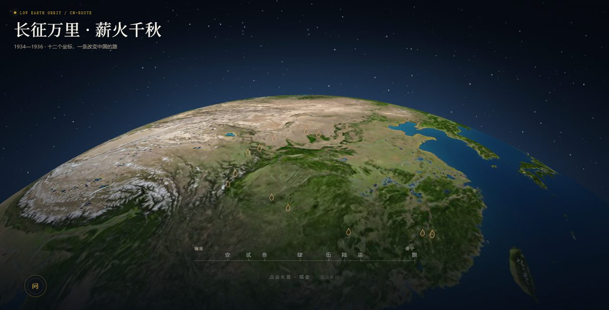

# 长征万里 · 薪火千秋

> 2026 武汉大学「零杯」网页设计大赛 · 主题三（长征胜利九十周年）
> 线上地址：<https://long-march.pages.dev>
> 队伍 / 队长：＿＿＿＿（提交前填写）



> 上图及 `docs/` 中现有截图为早期版本效果，当前界面以线上部署版本为准。

一个可以在三维地球上重走长征路的网页：1934—1936，十二个坐标、八个关键事件、两年两万五千里。转动地球、逐站点亮、读每一处的故事；它也可以回答你关于长征的提问。

---

## 一、我们想做什么

九十年前，红军用双腿丈量了两万五千里。今天大多数人对长征的印象是一张静态路线图——起点、终点、几个地名。

这个作品把那张图“立起来”：**一颗可以转动的三维地球，十二个真实经纬度的站点，一条会随着你的点击生长出来的火线。** 用户的动作不是“翻页”，而是“点亮下一站”；走完十二站，画面落到会宁，中国边界金线亮起，故事收束。

设计采用**暗色山河展场 + 纸色档案阅读**：地球与路线承载行进，浅色展签承载史料，宋体标题与黑体正文区分叙事和阅读。一屏只有一个主任务（走到下一站），文案只在该出现时出现。本轮视觉更新保留原有游览、点亮、事件与终章流程。

## 二、快速运行

需要 Node.js ≥ 20.19。

```bash
npm ci
npm run dev        # 开发：http://localhost:5173
```

演示 / 交付用构建版：

```bash
npm run build
npm start          # 内置服务器：http://localhost:8080
```

Windows 可直接双击 `start.bat`（自动构建并打开浏览器）。

> 核心内容（地球、路线、十二站、八事件、离线问答）不依赖任何后端；AI 问答是可选增强，没有密钥时自动降级为本地档案，不会报错或白屏。

## 三、技术栈与第三方库（比赛要求逐项注明）

| 名称 | 版本 | 用途 | 在项目中的具体作用 |
|---|---|---|---|
| Vue 3 | ^3.5.44 | 工程框架 | 组件化组织界面与状态（`App.vue` 统一管理 `screen / litIds / showingEvent / activeNode`） |
| Vite | ^8.3.5 | 构建工具 | 开发服务器、打包、资源哈希、按需压缩 |
| globe.gl | ^2.46.2 | 三维地球库（功能性库） | 渲染地球、经纬度坐标、标签锚点、路径数据 |
| three.js | ^0.187.0 | WebGL 底层（功能性库） | 地球材质（Phong + 法线/高光）、`Line2` 火线、星空与暗角 |
| d3-geo（随 globe.gl） | — | 几何计算 | 经纬度与三维坐标互转、路径插值 |
| fontTools | — | 开发阶段字体裁剪工具 | 由 `tools/build_fonts.py` 将字体裁剪为本地 WOFF2 子集并重命名；仅用于准备字体资源，不属于浏览器运行时依赖 |

**未使用** Bootstrap、Element Plus、Vue Element、Tailwind 等任何“预设样式 / 组件库”；界面全部为手写 CSS（`src/style.css` + 各组件 scoped 样式）。

后端（可选）：Cloudflare Pages Functions（`functions/api/chat.js`、`functions/api/stats.js`），调用 DeepSeek Chat，KV 存储点亮与提问计数；未配置时自动降级。

## 四、合规声明

- 未引入预设样式库、未套用现成页面模板；
- 功能性库的名称、用途、具体作用已在上表列明；
- 所有图片素材来源见「十一、素材与授权」，AI 生成图均标注为示意图；
- 代码可独立运行，无隐藏的外部依赖或私有接口。

## 五、功能清单

| 功能 | 说明 | 对应评分点 |
|---|---|---|
| 三维地球 | 8K 地球贴图 + 法线/高光，星空、暗角、大气光；拖拽旋转、滚轮缩放、双击复位 | 设计 / 技术 |
| 长征路线 | 十二站沿真实经纬度排布，火线按弧长生长 | 创意 / 内容 |
| 站点标记 | 十二枚火花剪影，未点亮空心描边、点亮实心带暖光；下一站脉冲呼吸 | 细节 |
| 八个关键事件 | 湘江、遵义、赤水、金沙江、泸定桥、夹金山、草地、会宁；历史示意图与纸色事件档案配合呈现 | 内容 / 素材 |
| 站点详情 | 纸色档案面板，保留导语 + 两小节 + 三个数字（时间/兵力/序号）+ 上下站 | 内容 / 交互 |
| 四层问答 | 预设（0 网络）→ 本地档案（<30ms）→ 手动联网流式 → 统计上报 | 技术 / 加分 |
| 终章 | 十二站点亮后自动进入，保留中国边界金线，以年代、结语与印章落款收束 | 设计 / 情感 |
| 响应式 | 面向 1920 / 1440 / 720 宽度及窄屏、短横屏调整版式，保持原有操作流程；本轮实际浏览器回归待完成 | 适配（加分） |

## 六、页面只有四个状态

| 状态 | 画面 | 代码标志 |
|---|---|---|
| 序章 | 地球自转、两行宋体标题、朱砂主入口、续行与设置、右下角「薪火」方印 | `screen === 'start'` |
| 俯瞰 | 地球 + 十二枚火花 + 底部路书 | `screen === 'overview'` |
| 事件 / 详情 | 暗色山河或历史示意图背景 + 纸色事件档案，或站点详情面板 | `showingEvent` / `activeNode` |
| 终章 | 地球 + 金线 + 年代与结语 + 「长征」印章落款 | `screen === 'finale'` |

没有路由、没有刷新，所有切换发生在同一屏内。

## 七、适配与性能

- 目标宽度：1920、1440、720；补充检查 390×844 窄屏和 844×390 短横屏。各组件通过手写 CSS 调整字号、间距、面板位置与滚动区域，保留原有操作流程。
- 兼容目标：Chrome 129；保留 `visualViewport`、`interactive-widget` 的移动端键盘兜底。
- 网络目标：正常网速与慢网均能完成核心游览；地球贴图继续异步加载，字体以本地 WOFF2 子集交付，设置系统字体回退。
- **本轮验证边界**：验收范围为生产构建、Vue 组件编译与结构检查。本轮尚未通过浏览器进行视觉验收；上述尺寸、Chrome 129、正常网速与慢网均待真机回归，不能将早期版本测试记录视为本轮通过记录。

## 八、后端与四层问答（技术亮点）

1. **预设问答**：十条常见问题，答案写死在前端，0 网络、0 延迟；
2. **本地档案**：自由提问先在本地检索十二站与八事件文案，30ms 内出答案，末尾给出处；
3. **联网**：用户主动点「再问一次 · 联网」才请求 Function → DeepSeek，流式返回（首字 4.5s 超时）；
4. **统计**：点亮与提问数写入 KV，`/api/stats` 提供只升不降的计数。

设计原则：现场网络不可控，前两层保证“永远有答案”，第三层才是增强。

## 九、目录结构

```
long_march/
├─ public/            地球/事件贴图、印章、边界数据、robots、sitemap、OG 图
│  └─ licenses/       Source Han Serif / Sans 的 OFL 1.1 许可
├─ src/
│  ├─ assets/fonts/   March Serif / Sans 本地 WOFF2 字体子集
│  ├─ components/     EarthGlobe / EventScene / DetailPanel / AskPanel / FinaleScreen …
│  ├─ lib/            story.js、storyExtra.js、data.js、presets.js、cameraRig.js、ai.js、archive.js
│  ├─ App.vue         全局状态与页面编排
│  └─ style.css       设计令牌
├─ functions/api/     Cloudflare Pages Functions（chat / stats）
├─ server.mjs         本地演示服务器（静态 + 同一份 API）
├─ docs/              README 截图
├─ tools/build_fonts.py  开发阶段字体子集重建脚本
└─ README.md / 概览.md
```

## 十、设计说明

- **整体**：暗色山河展场承托真实地理，纸色档案承托历史阅读；控制科幻辉光和装饰线，保留地球、火线与历史叙事的核心关系。
- **字体**：本地 `March Serif` 用于宋体标题，`March Sans` 用于黑体正文与界面。首屏标题分别按 72 / 60 / 38px 适应大屏、桌面与窄屏；正文与注释分层排版，不依赖系统是否安装思源字体。
- **色彩**：墨绿底 `#141714`、纸色 `#eae2d1`、朱砂 `#ac4233`、古铜 `#b99b6b`。朱砂用于主操作与重要标记，古铜用于少量年代和辅助强调；纸色阅读区使用深色文字。
- **界面**：手写 CSS 实现首屏、详情、事件、章节展签与终章，未新增 UI 组件库或现成模板。响应式改变布局与信息密度，不改变游览顺序和已有操作。
- **动效**：保留火线生长、火花点亮与场景切换；为装饰过渡提供系统 `prefers-reduced-motion` 和站内减少动效设置支持。
- **印章**：序章「薪火」为朱文方印、终章「长征」为火漆圆印，均为实拍质感底图去背后叠字。

## 十一、素材与授权

- 地球贴图：NASA Blue Marble 系列（公有领域）衍生处理；
- 中国边界：Natural Earth / world-atlas（公有领域），离线烘焙为 `public/geo/china-border.json`；
- 八张事件配图：AI 生成（示意图），仅作氛围，不代表真实历史影像；
- 两枚印章底图：AI 生成后去背处理；
- 字体：基于 Adobe **Source Han Serif（思源宋体）** 与 **Source Han Sans（思源黑体）**，遵循 SIL Open Font License 1.1。本地子集重命名为 `March Serif` / `March Sans`；保留系统字体作为加载失败时的回退。

本地分发的字体文件：

| 文件 | 字体与用途 |
|---|---|
| `src/assets/fonts/march-serif-semibold.woff2` | March Serif，宋体展示标题 |
| `src/assets/fonts/march-sans-regular.woff2` | March Sans，常规正文 |
| `src/assets/fonts/march-sans-medium.woff2` | March Sans，中等字重的界面文字 |

许可随项目提供：[Source Han Serif OFL](public/licenses/SourceHanSerif-OFL.txt)、[Source Han Sans OFL](public/licenses/SourceHanSans-OFL.txt)。字体子集可通过 [`tools/build_fonts.py`](tools/build_fonts.py) 重建；增改文案后应重新检查字符覆盖。fontTools 仅用于开发阶段裁剪与重命名，不会随页面作为运行时库加载。

三份 WOFF2 合计约 1.01 MB，覆盖当前源码中的 1,532 个汉字；使用 `font-display: swap`，慢网下先显示系统字体。动态问答出现子集之外的字时由系统字体补齐。字体文件已随源码提交，Cloudflare 的常规构建不需要运行字体工具或下载原始字体。

## 十二、部署（Cloudflare Pages + Functions）

- Build command：`npm ci && npm run build`
- Output directory：`dist`
- 环境变量：`DEEPSEEK_API_KEY`（Secret）、`DEEPSEEK_MODEL=deepseek-chat`
- KV 绑定：`STATS`

修改环境变量后需在 Deployments → Retry deployment 重新部署才生效。

## 十三、已知限制

- 真机（安卓）键盘避让与返回键需实机再验一次；
- 本轮 UI 更新的 Chrome 129、多尺寸、横屏与慢网视觉回归尚未完成；
- 十二站暂未配实景照片，视觉由事件图与地图承担；
- 3D 场景在低端设备上帧率会下降，已限制像素比与贴图尺寸。

## 十四、提交说明

- **完整版**：含本 README、队员信息、源码、`docs/` 截图；
- **匿名版**：删除队名/姓名/学号/学院信息，仅保留作品与介绍；
- 提交前执行 `npm ci && npm run build`，确认 `dist/` 可正常打开。
